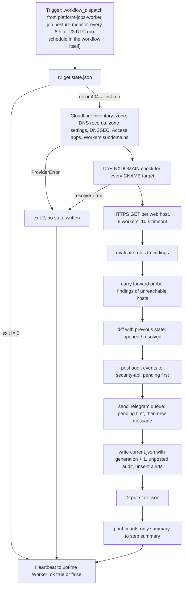
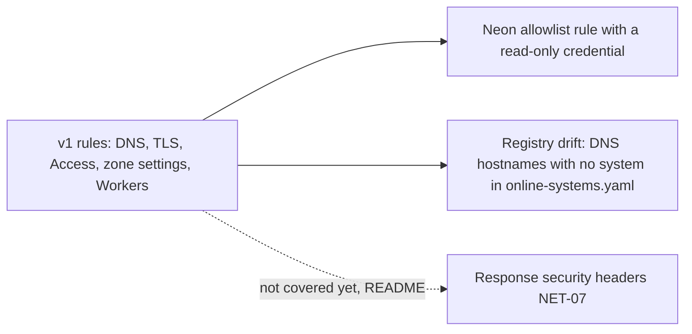

# 01 — Business process (As-Is / To-Be)

repo นี้คือ scheduled job (workflow GitHub Actions ที่ `platform-jobs-worker` สั่ง `workflow_dispatch` ทุก 6 ชั่วโมงตั้งแต่ 2026-11-17, Python standard library) ที่ตรวจ security posture ของ edge `bookchaowalit.com` แบบ read-only แล้วแจ้ง Telegram เฉพาะเมื่อ finding เปิดหรือปิด เป็นรูปแบบ "running system" ของ network review แบบ manual วันที่ 2026-11-02 (NET-01…NET-12)

Last reviewed: 2026-11-27 · commit `520db84`

## As-Is (จากโค้ดวันนี้)

Sources: `.github/workflows/posture.yml`, `posture_monitor/run.py`, `posture_monitor/collect.py`, `posture_monitor/checks.py`, `posture_monitor/report.py`, `posture_monitor/audit.py`, `posture_monitor/r2.py`, `README.md`

ประเด็นสำคัญของ As-Is
- owner เป็นคนแก้ปัญหาเอง (out of scope: automatic remediation — `PRODUCT.md`)
- ไม่มี message เมื่อไม่มีอะไรเปลี่ยน; รอบแรก (ไม่มี state) ส่ง baseline หนึ่งข้อความ (SPEC-001 R3)
- inventory ล้มเหลว = ไม่เขียน state เลย จึงไม่มีอะไร "resolve" เพราะ provider ล่ม (R4); ถ้า audit หรือ Telegram ล้มเหลว state ยังถูกเขียนพร้อม pending ไว้ส่งซ้ำรอบหน้า (exit 2 หรือ 3)

## To-Be (จาก `docs/specs/001-posture-monitor.md` "Later" และ `PRODUCT.md`)

Sources: `docs/specs/001-posture-monitor.md` (Later, Out of scope), `PRODUCT.md` (Capabilities and Constraints), `README.md` (Not covered yet)

## Gap

| ID | As-Is → To-Be | Status | Owner | Evidence |
|---|---|---|---|---|
| G1 | ไม่มี Neon allowlist rule → rule ที่ใช้ read-only credential | todo | claude | `docs/specs/001-posture-monitor.md` (Later); spec ระบุว่า credential Neon ปัจจุบันกว้างเกินไป จึงต้องมี credential ใหม่จาก owner |
| G2 | ไม่ตรวจ registry drift → เทียบ hostname ใน DNS กับ `online-systems.yaml` | todo | claude | `docs/specs/001-posture-monitor.md` (Later) |
| G3 | ไม่ตรวจ security headers (NET-07) → เป็น rule หรือยัง out of scope | decide | owner | README (Not covered yet) ขัดกับ SPEC-001 (out of scope) |

## Open questions

- ไม่มีวันเป้าหมายของ Neon allowlist rule และ registry drift (G1, G2)
