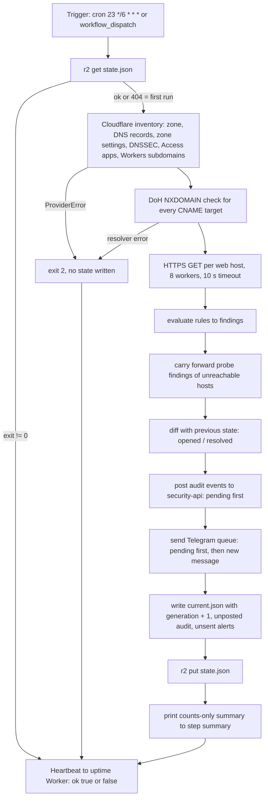
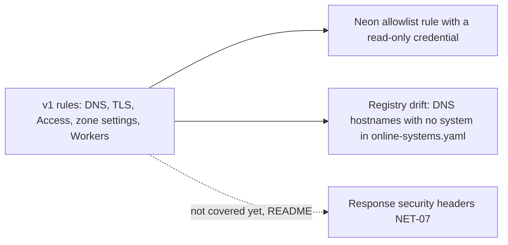

# 01 — Business process (As-Is / To-Be)

repo นี้คือ scheduled job (GitHub Actions ทุก 6 ชั่วโมง, Python standard library) ที่ตรวจ security posture ของ edge `bookchaowalit.com` แบบ read-only แล้วแจ้ง Telegram เฉพาะเมื่อ finding เปิดหรือปิด เป็นรูปแบบ "running system" ของ network review แบบ manual วันที่ 2026-11-02 (NET-01…NET-12)

## As-Is (จากโค้ดวันนี้)

Sources: `.github/workflows/posture.yml`, `posture_monitor/run.py`, `posture_monitor/collect.py`, `posture_monitor/checks.py`, `posture_monitor/report.py`, `posture_monitor/audit.py`, `posture_monitor/r2.py`, `README.md`

ประเด็นสำคัญของ As-Is
- owner เป็นคนแก้ปัญหาเอง (out of scope: automatic remediation — `PRODUCT.md`)
- ไม่มี message เมื่อไม่มีอะไรเปลี่ยน; รอบแรก (ไม่มี state) ส่ง baseline หนึ่งข้อความ (SPEC-001 R3)
- inventory ล้มเหลว = ไม่เขียน state เลย จึงไม่มีอะไร "resolve" เพราะ provider ล่ม (R4)

## To-Be (จาก `docs/specs/001-posture-monitor.md` "Later" และ `PRODUCT.md`)

Sources: `docs/specs/001-posture-monitor.md` (Later, Out of scope), `PRODUCT.md` (Capabilities and Constraints), `README.md` (Not covered yet)

## Open questions

- Response security headers (NET-07) อยู่ใน "Not covered yet" ของ README แต่ SPEC-001 บอกว่า out of scope เพราะ provider-wide: จะเป็น rule ในอนาคตหรือไม่
- ไม่มีวันเป้าหมายของ Neon allowlist rule และ registry drift
