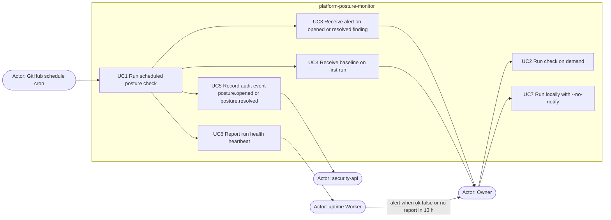

# 02 — Use cases

ไม่มี user login หรือ UI; actor คือ trigger, ผู้รับผล และ service ที่ job เรียก ตามโค้ดและ workflow

Sources: `.github/workflows/posture.yml` (`schedule`, `workflow_dispatch`, Heartbeat step), `posture_monitor/run.py` (`main`, `--no-notify`, `--require-audit`), `posture_monitor/audit.py`, `PRODUCT.md` (Users), `README.md` (Local run)

| Use case | Actor | Auth level in code |
|---|---|---|
| UC1 / UC2 | GitHub cron, owner (Actions UI) | repo Actions secrets; `permissions: contents: read` |
| UC3 / UC4 | owner via Telegram | bot token + chat id (`TELEGRAM_BOT_TOKEN`, `TELEGRAM_CHAT_ID`) |
| UC5 | security-api | identity service client `posture-monitor`, `private_key_jwt`, audience `security-api`, scope `audit:write` |
| UC6 | uptime Worker | `HEARTBEAT_TOKEN` bearer |
| UC7 | owner on own machine | `infisical run --path /posture-monitor` |

## Open questions

- ไม่พบผู้อ่าน audit event `posture.*` ใน security-api จาก repo นี้ (มีแค่ฝั่งเขียน); ใครใช้ข้อมูลนี้ต่อ
