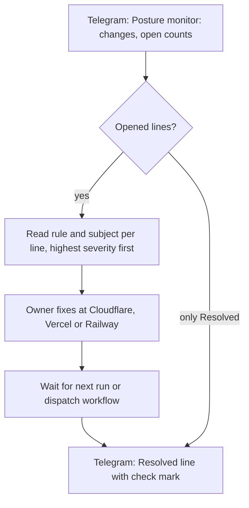
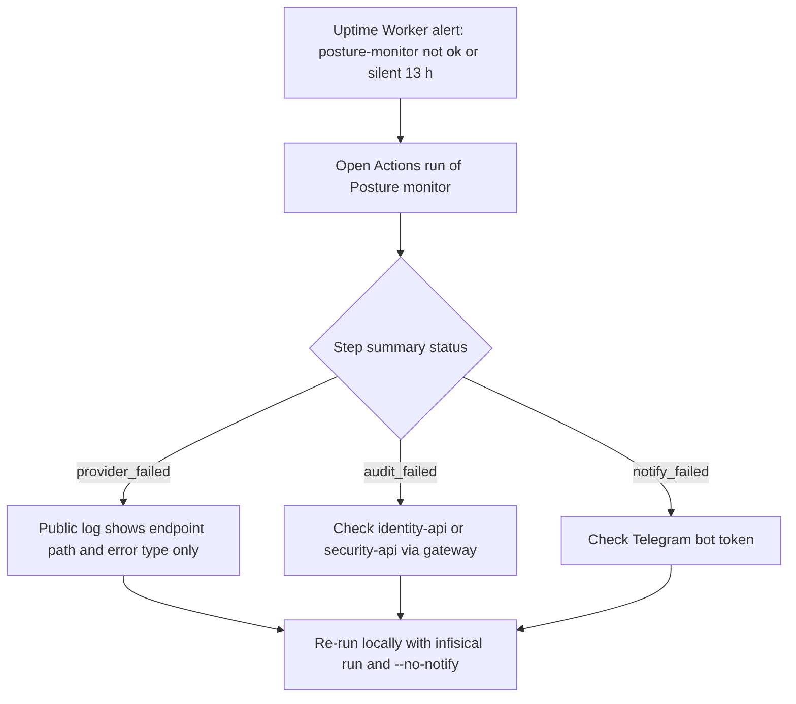
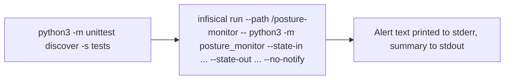

# 03 — User flows

ไม่มี route หรือ page; "flow" คือเส้นทางที่ owner เจอจริงผ่าน Telegram, GitHub Actions และ CLI

## Flow A — Owner ได้รับ alert แล้วแก้ edge

Sources: `posture_monitor/report.py` (`message`, `ICON`, `MAX_LINES`), `.github/workflows/posture.yml` (`workflow_dispatch`), `PRODUCT.md` (out of scope: automatic remediation)

## Flow B — Owner ได้ heartbeat alert (run ล้มหรือหายไป)

Sources: `posture_monitor/run.py` (status values, exit codes), `posture_monitor/collect.py` (`ProviderError` message), `README.md` (How it runs, Local run)

## Flow C — Local run

Sources: `README.md` (Local run), `posture_monitor/run.py` (`--no-notify`)

## Open questions

- ไม่มี runbook ที่เขียนไว้ว่า owner ต้องทำอะไรต่อ rule แต่ละตัว (เช่น `tunnel-no-access` ต้องสร้าง Access app แบบไหน)
