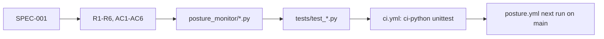

# 04 — Traceability (RTM)

requirement จาก [SPEC-001](../specs/001-posture-monitor.md) (R1–R6, AC1–AC6) เชื่อมกับ module, test และ workflow ที่ปล่อยจริง

| Req | Statement (short) | Code module | Test | Release / workflow |
|---|---|---|---|---|
| R1 Read-only | ไม่เปลี่ยน provider state; token read-only + R2 bucket เดียว | `collect.py` (GET only), `r2.py` (bucket `posture-monitor`) | — (no test; enforced by token scope) | `posture.yml` secrets |
| R2 Public log quiet | log พิมพ์แค่ counts และ error type | `report.py` `public_summary`, `collect.py` `ProviderError`, `audit.py` `_call` | `test_report.py` `PublicSummary.test_counts_only`; `test_run.py` `test_public_output_has_no_hostname`; `test_collect.py` `test_failure_raises_without_details` | `posture.yml` stderr to `$RUNNER_TEMP` |
| R3 Alert on change | id `<rule>:<subject>`, diff, baseline รอบแรก | `checks.py` `Finding.id`, `report.py` `diff`/`message` | `test_report.py` `Diff.*`; `test_run.py` `test_first_run_sends_baseline_and_writes_state`, `test_unchanged_run_sends_nothing` | `posture.yml` |
| R4 Fail loudly | provider error → exit 2, เก็บ state เดิม, heartbeat ok false | `run.py` `run`, `collect.py` `target_exists` | `test_run.py` `test_provider_failure_keeps_state`; `test_collect.py` `test_other_status_fails_the_run`, `test_unsuccessful_body_raises` | `posture.yml` Heartbeat step |
| R5 Bounded | timeout 10 s, 8 workers, < 5 นาที | `collect.py` `TIMEOUT`, `WORKERS` | — (no timing test) | `posture.yml` `timeout-minutes: 10` |
| R6 Stdlib only | ไม่มี third-party runtime dependency | all modules; `audit.py` uses `openssl` binary; `r2.py` SigV4 | `test_audit.py` `test_signature_verifies_with_public_key`; `test_r2.py` `Signing.*` | `ci.yml` (no install step) |
| AC1 | tunnel ไม่มี Access = high | `checks.py` `_tunnel_rules`, `access_covers`; `collect.py` `enforcing_domains` | `test_checks.py` `TunnelAccess.*`; `test_collect.py` `AccessApps.*` | `ci.yml` |
| AC2 | probe → TLS / deployment rules | `checks.py` `_probe_rules`; `collect.py` `probe` | `test_checks.py` `ProbeRules.*` | `ci.yml` |
| AC3 | zone settings rules | `checks.py` `_zone_rules` | `test_checks.py` `ZoneRules.*` | `ci.yml` |
| AC4 | diff = opened/resolved, ไม่เปลี่ยนไม่มี message | `report.py` `diff`, `message` | `test_report.py` `Diff.*` | `ci.yml` |
| AC5 | provider error ไม่แตะ state, exit 2 | `run.py` `run` | `test_run.py` `test_provider_failure_keeps_state`; `test_collect.py` `Api.*` | `ci.yml` |
| AC6 | public summary ไม่มี hostname | `report.py` `public_summary` | `test_report.py` `test_counts_only`; `test_run.py` `test_public_output_has_no_hostname` | `ci.yml` |
| Audit trail | event ต่อ change, idempotent, retry | `audit.py` `AuditSink`, `idempotency_key`, `event_target`; `run.py` pending_audit | `test_audit.py` `Events.*`, `Partial.*`; `test_run.py` `test_failed_audit_events_are_kept_...`, `test_audit_gets_the_changes_...` | `posture.yml` `--require-audit` |
| `--require-audit` | ไม่มี key = exit 2 ก่อนเรียก provider | `run.py` `main` | `test_run.py` `RequireAudit.test_missing_audit_key_fails_before_any_provider_call` | `posture.yml` |

Sources: `docs/specs/001-posture-monitor.md`, `posture_monitor/*.py`, `tests/*.py`, `.github/workflows/ci.yml`, `.github/workflows/posture.yml`

## Gaps

- R1 และ R5 ไม่มี automated test (R1 พึ่ง token policy, R5 ไม่มีการวัดเวลา)
- ไม่มี release tag; "release" = commit บน `main` ที่ run รอบถัดไปใช้

## Open questions

- ต้องการ test ที่ยืนยัน R5 (เวลา run ~150 hostnames < 5 นาที) หรือดูจาก run duration ใน Actions พอ
