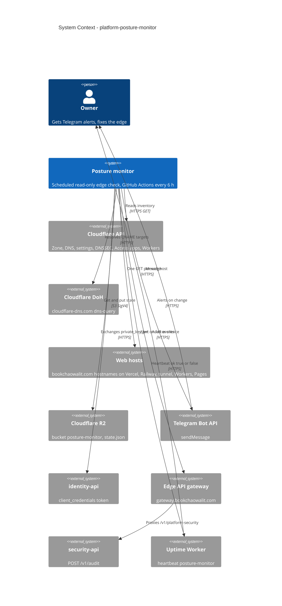

# 05 — C4 Context

Sources: `posture_monitor/collect.py` (`API`, `DOH`, `probe`), `posture_monitor/r2.py`, `posture_monitor/run.py` (`telegram`), `posture_monitor/audit.py` (`IDENTITY`, `SECURITY_API`), `.github/workflows/posture.yml` (Heartbeat URL), ops record: api-gateway-edge (2026-11-03)

## Open questions

- uptime Worker ส่ง alert ไปช่องทางไหน (Telegram ตัวเดียวกันหรือไม่) ไม่ได้ระบุใน repo นี้
