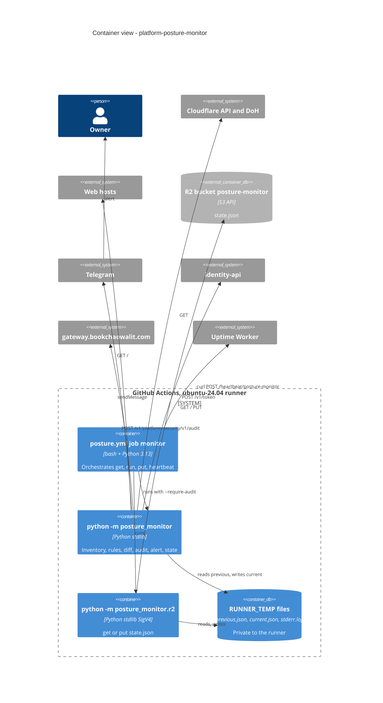

# 06 — C4 Container

Sources: `.github/workflows/posture.yml`, `posture_monitor/__main__.py`, `posture_monitor/run.py`, `posture_monitor/r2.py`, `posture_monitor/audit.py`, `posture_monitor/collect.py`

หมายเหตุ: `$GITHUB_STEP_SUMMARY` ได้แค่ stdout (counts-only summary); stderr ไปเก็บใน `$RUNNER_TEMP/stderr.log` เพื่อไม่ให้ขึ้น public log (R2)
