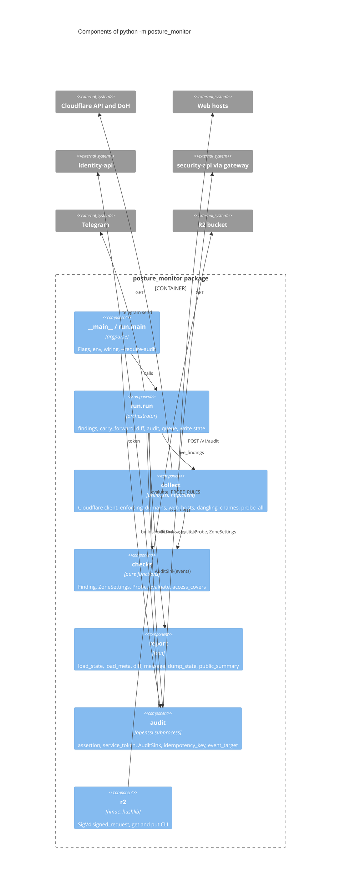

# 07 — C4 Component

Sources: `posture_monitor/__main__.py`, `posture_monitor/run.py`, `posture_monitor/collect.py`, `posture_monitor/checks.py`, `posture_monitor/report.py`, `posture_monitor/audit.py`, `posture_monitor/r2.py`

หมายเหตุ: `audit.py` import `ProviderError` จาก `collect.py` ทำให้ audit failure ใช้ exception ชนิดเดียวกับ provider failure
