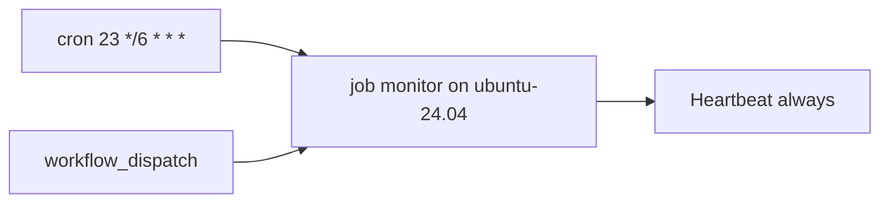

# ADR-0001 — Run as a scheduled GitHub Actions job on a GitHub-hosted runner

- Status: accepted (retro-documented, 2026-11-03)
- Date of decision: 2026-11-03 (`63eccfe`)

## Context

ต้องการให้ network review แบบ manual (NET-01…NET-12) กลายเป็นระบบที่รันเองต่อเนื่อง (SPEC-001 Problem/Outcome) โดยไม่ต้องมี service ที่ต้องดูแล

## Decision

รันเป็น workflow `posture.yml` บน `ubuntu-24.04` (GitHub-hosted) cron `23 */6 * * *` + `workflow_dispatch`, `concurrency: posture-monitor` (ไม่ cancel), `timeout-minutes: 10` เพราะ repo เป็น public จึงใช้ GitHub-hosted runner ตาม CI hosting policy

## Consequences

- ไม่มี hosted runtime, ไม่มี domain; "deploy" = push เข้า `main`
- log เป็น public จึงต้องเก็บรายละเอียดไว้นอก log (ดู ADR-0003 / R2)
- GitHub schedule อาจเลื่อนเวลา; heartbeat 13 h ครอบคลุม run ที่หาย

Evidence / Sources: `.github/workflows/posture.yml`, `README.md` (How it runs), `PRODUCT.md` (Operating Context), ops record: posture-monitor (2026-11-03), ops record: ci-hosting-policy (2026-11-03)
