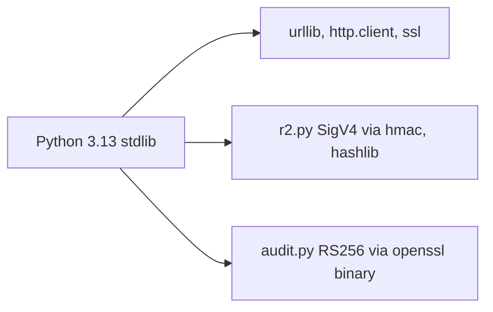

# ADR-0002 — Standard library only (no third-party runtime dependency)

- Status: accepted (retro-documented, 2026-11-03)

## Context

job ถือ credential ของ Cloudflare, R2, Telegram และ identity private key; SPEC-001 R6 ต้องการไม่มี supply-chain surface นอกจาก Python เอง

## Decision

ใช้แค่ stdlib: `urllib`/`http.client`/`ssl` สำหรับ HTTP, SigV4 เขียนเองใน `r2.py`, RS256 สำหรับ `private_key_jwt` เซ็นด้วย binary `openssl dgst -sha256 -sign` ผ่าน `subprocess` ใน `audit.py` (ไม่มี `cryptography`/`PyJWT`)

## Consequences

- ไม่มี lock file, ไม่มี install step ใน CI (`ci.yml` comment)
- พึ่ง `openssl` binary บน runner; private key ถูกเขียนลง temp file ชั่วคราวแล้วลบใน `finally`
- ไม่มี Sentry SDK (ดู ADR-0005)

Evidence / Sources: `docs/specs/001-posture-monitor.md` (R6), `posture_monitor/r2.py`, `posture_monitor/audit.py` (`assertion`), `.github/workflows/ci.yml`, `tests/test_audit.py`, `tests/test_r2.py`
