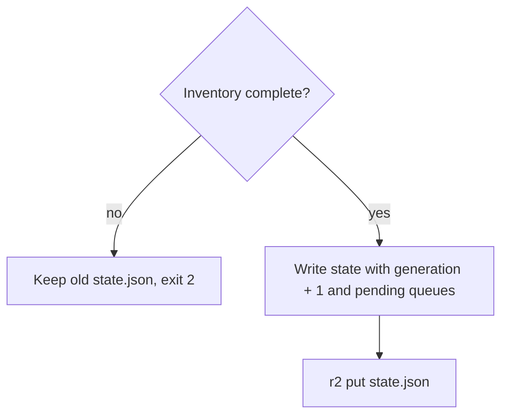

# ADR-0003 — State in private R2; a failed inventory never replaces it

- Status: accepted (retro-documented, 2026-11-03)

## Context

ต้องรู้ว่า finding ไหน "เปิด/ปิด" ระหว่าง run บน runner ที่ไม่มี disk ถาวร และ repo เป็น public (เก็บ state ใน repo ไม่ได้) และ provider ที่ล่มต้องไม่ทำให้ finding ถูก resolve ผิด ๆ (R4)

## Decision

- `state.json` (version 3) อยู่ใน R2 bucket `posture-monitor` อ่าน/เขียนผ่าน `python -m posture_monitor.r2`
- `ProviderError` ใด ๆ ใน inventory → exit 2, ไม่เขียน `current.json` จึงไม่ put
- host ที่ unreachable คง probe finding เดิม (`carry_forward`)
- หลัง inventory สมบูรณ์ เขียน state เสมอ แม้ audit/Telegram ล้ม โดยเก็บ `pending_audit` / `pending_messages` (สูงสุด 5) ไว้ retry

## Consequences

- state ไม่มี versioning/backup แยก (ดู 14-backup-dr)
- generation ทำให้ idempotency key ของ audit คงที่เมื่อ retry

Evidence / Sources: `posture_monitor/run.py` (`run`, `carry_forward`), `posture_monitor/report.py` (`dump_state`, `load_meta`, `MAX_PENDING`), `posture_monitor/r2.py`, `.github/workflows/posture.yml`, `tests/test_run.py`, commits `93bd5fe`, `6d613f6`
