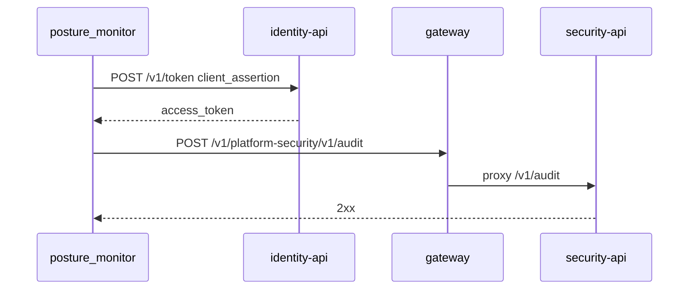

# ADR-0004 — Audit trail in security-api with an identity service client, through the edge gateway

- Status: accepted (retro-documented, 2026-11-03)

## Context

Telegram อย่างเดียวไม่มีประวัติที่ query ได้; SPEC-001 "Audit trail (added 2026-11-03)" กำหนดให้ทุก change เป็น audit event

## Decision

- monitor เป็น platform-identity service client `posture-monitor`: `client_credentials` + `private_key_jwt` (RS256), audience `security-api`, scope `audit:write`
- POST `{action: posture.opened|posture.resolved, target}` ไปที่ `https://gateway.bookchaowalit.com/v1/platform-security/v1/audit` พร้อม `Idempotency-Key` จาก change + finding id + generation
- token endpoint ของ identity เรียกตรง (`identity-api-production-fad1.up.railway.app`) ไม่ผ่าน gateway
- hosted run ใช้ `--require-audit`

## Consequences

- rollback = เปลี่ยน `SECURITY_API` กลับเป็น direct URL ใน `audit.py`
- audit ล้ม → exit 2 แต่ state ยังเขียนพร้อม `pending_audit`

Evidence / Sources: `posture_monitor/audit.py`, `posture_monitor/run.py`, `docs/specs/001-posture-monitor.md`, `README.md`, commits `db7af24`, `3022ef5`, ops record: api-gateway-edge (2026-11-03), ops record: book-platforms-status (2026-11-03)
