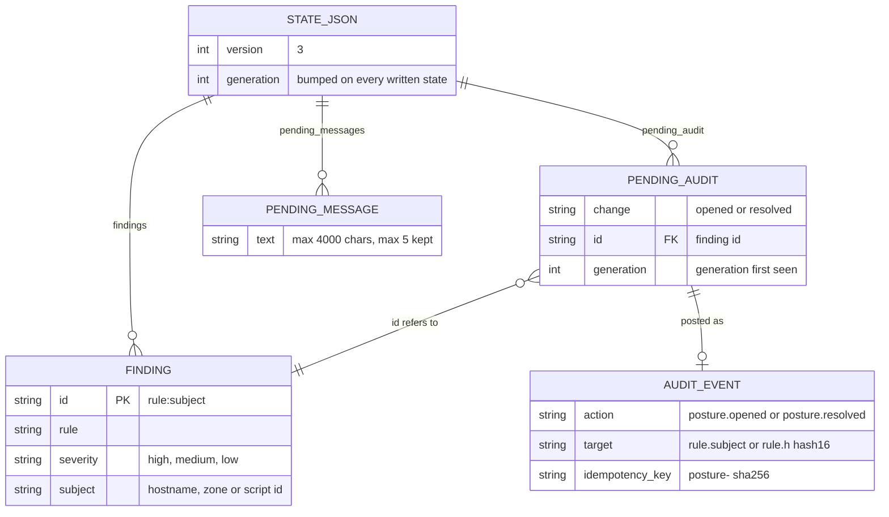

# 09 — ERD (persisted data)

ไม่มี database; ข้อมูลที่ persist มีอย่างเดียวคือ object `state.json` (version 3) ใน R2 bucket `posture-monitor` นอกจากนั้นคือ audit event ที่ถูกเขียนลง security-api (ระบบอื่นเป็นเจ้าของ schema)

Sources: `posture_monitor/report.py` (`dump_state`, `load_state`, `load_meta`, `bound`, `cap_pending`, `MAX_CHARS`, `MAX_PENDING`), `posture_monitor/checks.py` (`Finding.as_dict`), `posture_monitor/run.py` (events), `posture_monitor/audit.py` (`event_target`, `idempotency_key`, `AuditSink`), `posture_monitor/r2.py` (`BUCKET`)

หมายเหตุ: `load_meta` ยังอ่าน state version 2 ได้ (field `pending_message` แบบ string เดียว)

ข้อมูลชั่วคราว (ไม่ persist): `ZoneSettings`, `Probe`, DNS records list และ Access domains อยู่ใน memory ระหว่าง run เท่านั้น

## Open questions

- schema ฝั่ง security-api ของ audit event (workspace, actor, timestamps) อยู่ใน platform-security repo ไม่ได้อ่านในรอบนี้
