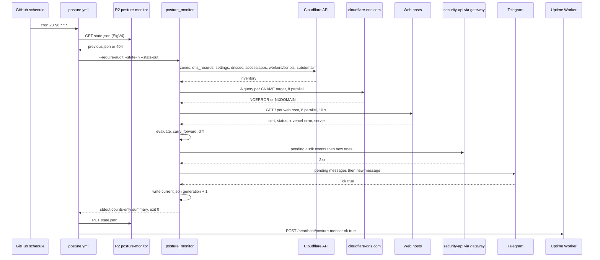
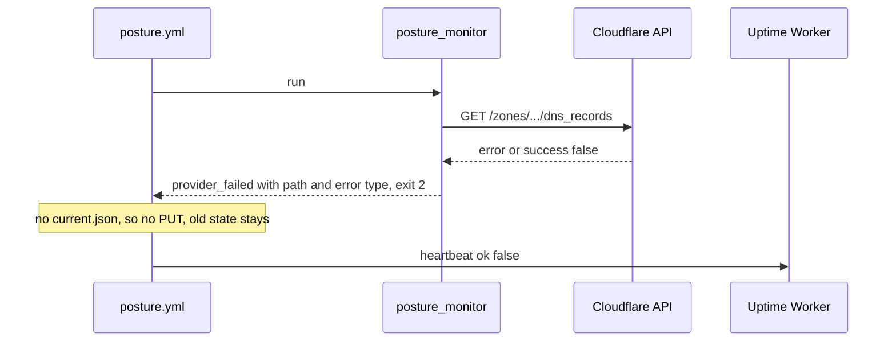
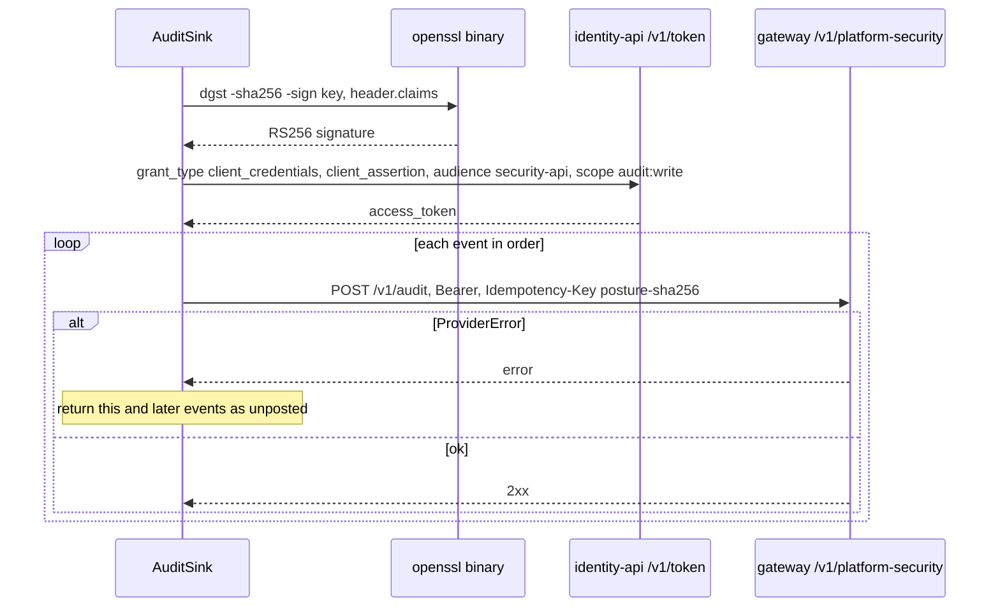
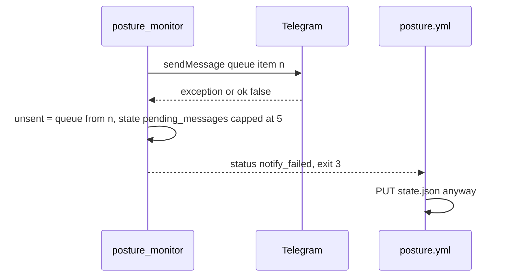

# 10 — Sequences

## S1 — Scheduled run, happy path with a change

Sources: `.github/workflows/posture.yml`, `posture_monitor/run.py`, `posture_monitor/collect.py` (`Cloudflare.inventory`, `dangling_cnames`, `probe_all`), `posture_monitor/audit.py`, `posture_monitor/r2.py`

## S2 — Provider failure (AC5)

Sources: `posture_monitor/collect.py` (`Cloudflare.get`, `ProviderError`), `posture_monitor/run.py` (`run`), `.github/workflows/posture.yml`, `tests/test_run.py` (`test_provider_failure_keeps_state`)

## S3 — Audit token exchange and idempotent post

Sources: `posture_monitor/audit.py` (`assertion`, `service_token`, `post_event`, `AuditSink`, `idempotency_key`), `tests/test_audit.py`

## S4 — Telegram failure keeps alert for next run

Sources: `posture_monitor/run.py` (`run`, `telegram`), `posture_monitor/report.py` (`cap_pending`), `.github/workflows/posture.yml`, `tests/test_run.py` (`test_notify_failure_keeps_the_alert_for_the_next_run`, `test_pending_queue_is_capped`)
