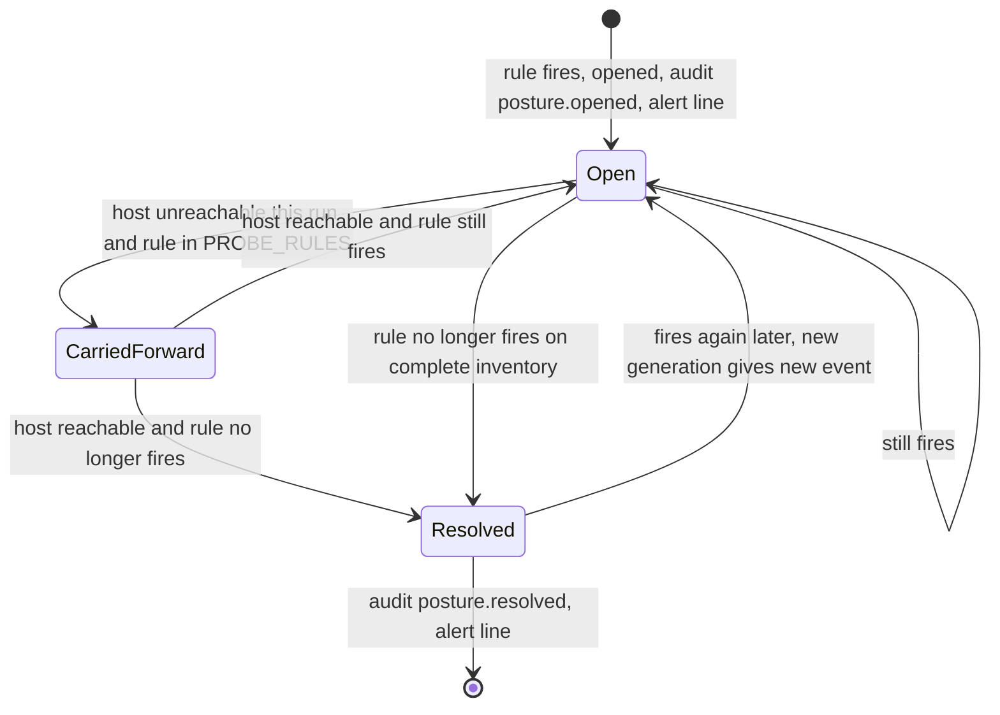
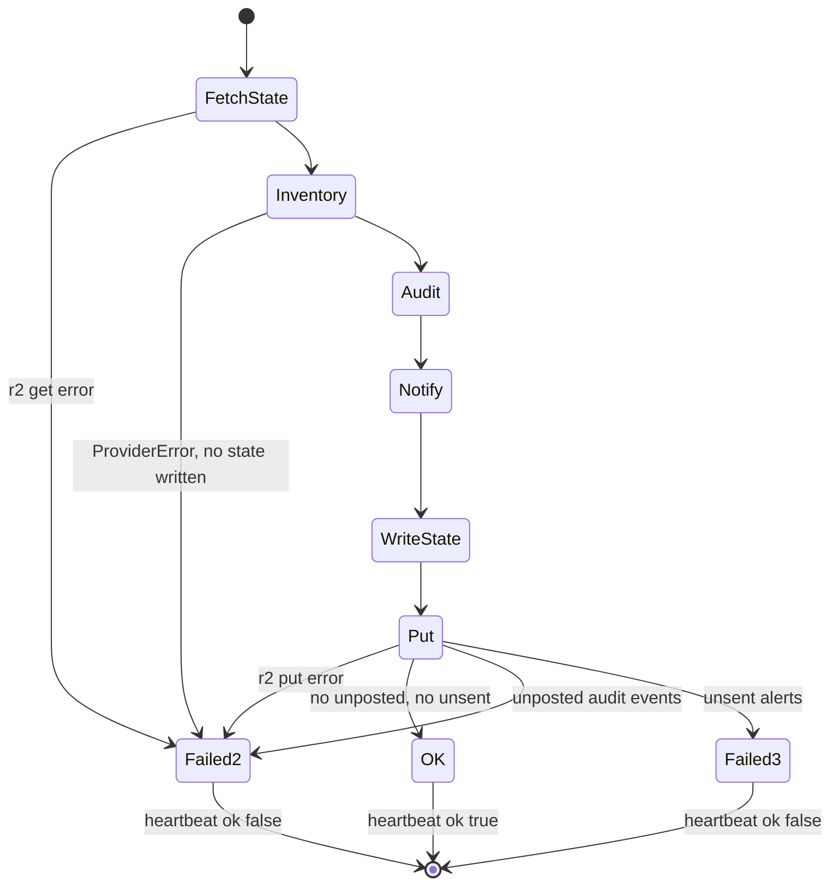
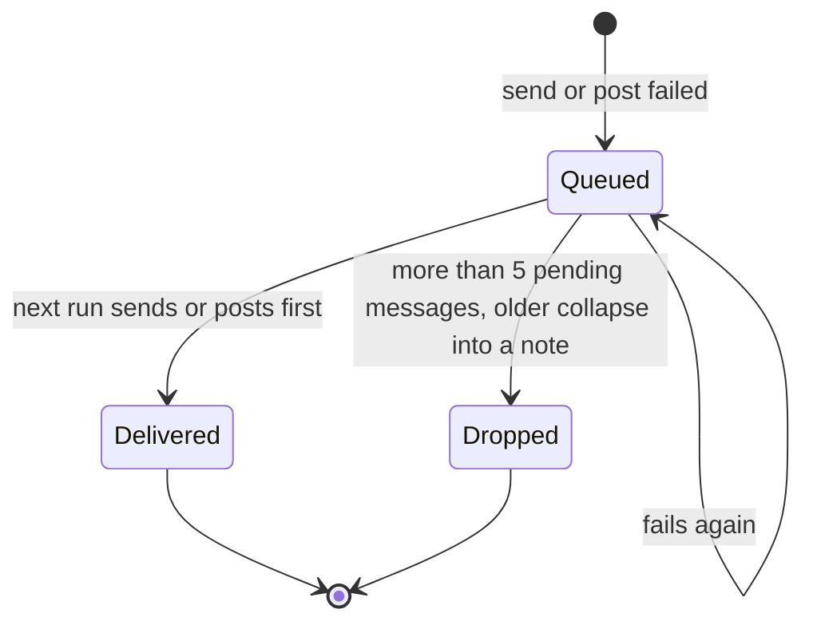

# 11 — State machines

## Finding lifecycle (across runs)

Sources: `posture_monitor/run.py` (`carry_forward`), `posture_monitor/checks.py` (`PROBE_RULES`), `posture_monitor/report.py` (`diff`), `posture_monitor/audit.py` (`idempotency_key`), `tests/test_run.py` (`test_unreachable_host_keeps_its_probe_finding`)

## Run outcome (exit code to heartbeat)

Sources: `posture_monitor/run.py` (`OK`, `PROVIDER_FAILED`, `NOTIFY_FAILED`), `.github/workflows/posture.yml`

## Pending alert / audit queues

Sources: `posture_monitor/run.py`, `posture_monitor/report.py` (`cap_pending`, `MAX_PENDING`), `tests/test_run.py` (`test_pending_queue_is_capped`, `test_failed_audit_events_are_kept_with_their_generation_and_retried_first`)

หมายเหตุ: `pending_audit` ไม่มี cap (มีแค่ `pending_messages` ที่ cap ที่ 5)
