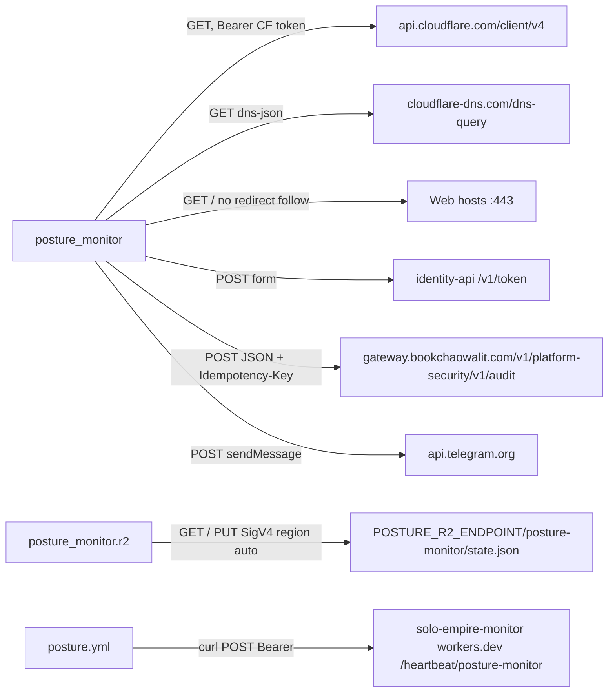

# 12 — API & integrations

repo นี้ไม่เปิด endpoint ใด ๆ; เป็น client อย่างเดียว ด้านล่างคือทุก outbound call ที่พบในโค้ด

| Integration | Method / path | Auth | Timeout | Failure handling | Source |
|---|---|---|---|---|---|
| Cloudflare zones | `GET /zones?name=` | Bearer `CLOUDFLARE_API_TOKEN` | 30 s | `ProviderError` (path + type) | `collect.py` |
| DNS records | `GET /zones/{id}/dns_records` paged 100 | same | 30 s | same | `collect.py` `paged` |
| Zone settings | `GET /zones/{id}/settings/{ssl,min_tls_version,always_use_https,security_header}` | same | 30 s | same | `collect.py` |
| DNSSEC | `GET /zones/{id}/dnssec` | same | 30 s | same | `collect.py` |
| Access apps | `GET /accounts/{acct}/access/apps` paged | same | 30 s | same | `collect.py` `enforcing_domains` |
| Workers | `GET /accounts/{acct}/workers/scripts`, `.../{id}/subdomain` | same | 30 s | same | `collect.py` |
| DoH | `GET dns-query?name=&type=A` | none | 10 s | non NOERROR/NXDOMAIN → `ProviderError` | `collect.py` `target_exists` |
| Web probe | `GET /` UA `posture-monitor/1`, read 4096 bytes | none | 10 s | unreachable = no verdict; cert error = `tls-invalid` | `collect.py` `probe` |
| identity token | `POST /v1/token` `client_credentials` + `private_key_jwt` | RS256 assertion, exp 120 s | 30 s | `ProviderError` → all events stay pending | `audit.py` `service_token` |
| security-api audit | `POST /v1/audit` via gateway | Bearer service token | 30 s | events from first failure stay pending | `audit.py` `post_event` |
| Telegram | `POST /bot{token}/sendMessage` | bot token in URL | 20 s | exception → unsent queue, exit 3 | `run.py` `telegram` |
| R2 | `GET`/`PUT /{bucket}/{key}` | SigV4 `POSTURE_R2_ACCESS_KEY_ID` | 30 s | 404 on get = first run; other error exit 2 | `r2.py` |
| Heartbeat | `POST /heartbeat/posture-monitor` `{"ok":..,"failed":[..]}` | Bearer `HEARTBEAT_TOKEN` | curl default | `curl -fsS` fails the step | `posture.yml` |

Sources: `posture_monitor/collect.py`, `posture_monitor/audit.py`, `posture_monitor/run.py`, `posture_monitor/r2.py`, `.github/workflows/posture.yml`, `README.md` (Credentials)

Probe markers ที่ map เป็น rule: header `x-vercel-error` = `DEPLOYMENT_NOT_FOUND` / `DEPLOYMENT_PAUSED`; header `server` มี `railway` และ body มี `Application not found` (`collect.py` `probe`, `checks.py` `_probe_rules`)

## Open questions

- `api.telegram.org` URL มี bot token อยู่ใน path; urllib exception message ไม่ถูกพิมพ์ออก public log (ถูก catch ใน `run`) แต่ควรยืนยันว่าไม่มีทางรั่วผ่าน stderr.log ถ้าวันหนึ่ง log นั้นถูก upload
