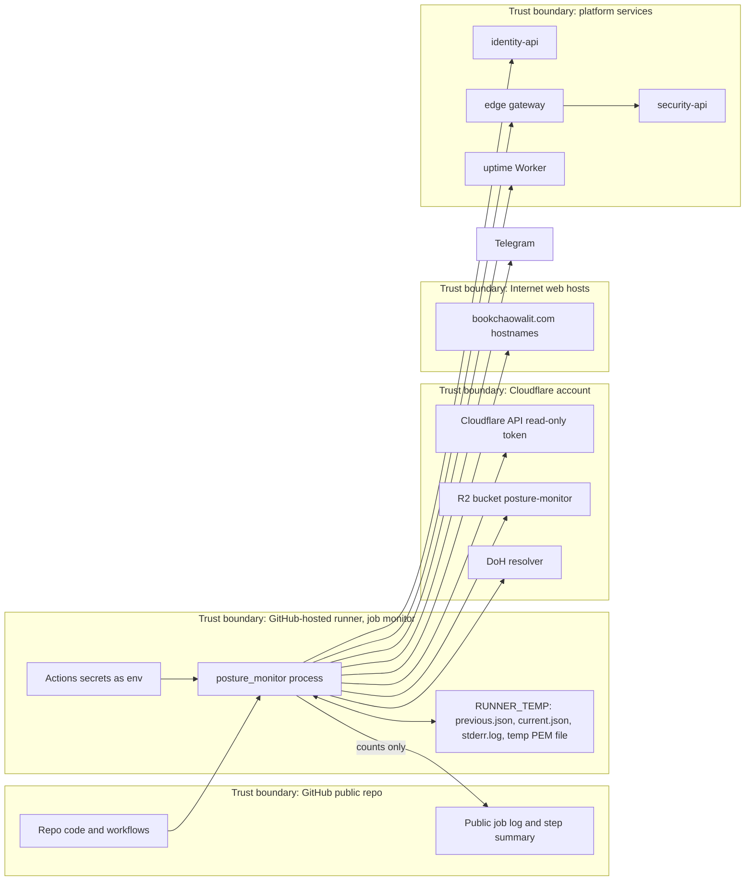

# 13 — Threat model (DFD + STRIDE)

Sources: `.github/workflows/posture.yml`, `posture_monitor/*.py`, `README.md` (Credentials), `docs/specs/001-posture-monitor.md` (R1, R2)

## STRIDE per element

| Element | Threat (STRIDE) | Existing mitigation in code | Gap |
|---|---|---|---|
| Public job log | **I** hostnames / findings leak to anyone | stdout = `public_summary` counts only; stderr → `$RUNNER_TEMP/stderr.log`; `ProviderError` carries path + type only (`collect.py`, `audit.py`); tests AC6 | `tee` writes summary only; `curl -fsS` in Heartbeat may print an error line (no secret) |
| Actions secrets | **I/E** token theft by malicious PR | `posture.yml` triggers only `schedule` and `workflow_dispatch` (no `pull_request`), `permissions: contents: read`, `persist-credentials: false`, actions SHA-pinned | `main` has no branch protection / ruleset (GitHub API 404 / `[]`), so a push to `main` runs with secrets on the next run |
| Cloudflare token | **E/T** token abused to change edge | token read-only + R2 write on one bucket (README, R1) | scope enforced by Cloudflare policy, not by tests |
| R2 state | **T** forged `state.json` | bucket private, SigV4 credentials scoped to the bucket | no integrity check on state: findings removed from state just re-open loudly on the next diff, but injected `pending_messages` would be sent to Telegram as-is and injected findings would show as "resolved" |
| R2 state | **D** state deleted | 404 = first run → baseline message (loud, not silent) | no object versioning noted |
| DoH resolver | **S/T** spoofed NOERROR hides a dangling CNAME | HTTPS to cloudflare-dns.com; SERVFAIL etc. fail the run | single resolver |
| Web hosts | **S** attacker host returns markers to create noise | only a GET `/`, 4096 bytes read, cert verified with default context | none needed (read-only) |
| Web hosts | **D** slow hosts stall run | 10 s timeout, 8 workers, job `timeout-minutes: 10` | — |
| Access check | **E** open host hidden behind a non-enforcing app | `enforcing_domains` ignores bypass-everyone and allow-everyone apps; path-scoped apps don't cover host (`access_covers`), commit `c5fb094` | policies read from app object only; account-level reusable policies not checked (unknown) |
| Identity private key | **I** key leak | key only in env; written to `mkstemp` file and unlinked in `finally`; public half only in identity | temp file on shared runner disk briefly; mode from `mkstemp` (0600) |
| Service token | **E** token over-scoped | audience `security-api`, scope `audit:write`, assertion exp 120 s | — |
| security-api audit | **R** monitor denies or duplicates events | `Idempotency-Key` per change+id+generation; pending retried with original generation | `pending_audit` unbounded |
| Telegram | **I** alert contents in a third-party chat | bot to owner chat; length bounded | Telegram is outside the platform |
| Telegram | **D** missed alerts | `pending_messages` retry, exit 3 → heartbeat false | queue capped at 5, older collapse into a note pointing to security-api |
| Heartbeat | **D/R** monitor silently stops | `if: always()`; uptime Worker alerts after 13 h silence | heartbeat failure itself only fails the step |
| Supply chain | **T** malicious dependency | stdlib only (R6), shared `security.yml` (gitleaks, semgrep, osv-scanner, trivy-fs) | depends on runner `openssl` binary |

Sources: `.github/workflows/posture.yml`, `.github/workflows/ci.yml`, `posture_monitor/collect.py`, `posture_monitor/audit.py`, `posture_monitor/report.py`, `posture_monitor/run.py`, `README.md`, platform-ci-workflows `security.yml` @ `87dc5e1c`, `gh api repos/bookchaowalit/platform-posture-monitor/branches/main/protection` (404, 2026-11-03)

## Open questions

- จะเปิด branch protection / ruleset บน `main` หรือไม่ (ตอนนี้ไม่มี)
- เปิด object versioning บน bucket `posture-monitor` แล้วหรือยัง
- Access reusable policies (ถ้ามี) ไม่อยู่ใน `app.policies` — ต้องตรวจเพิ่มหรือไม่
