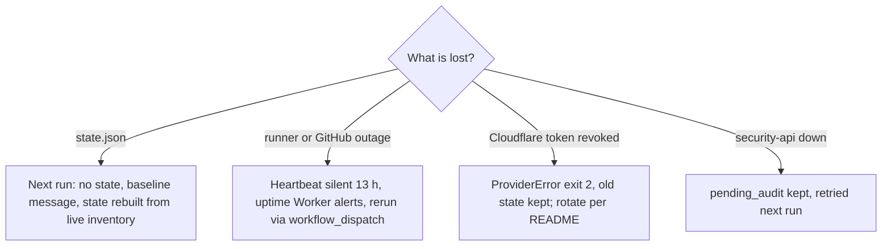

# 14 — Backup & DR

| Data | Where | Owner of backup | Backup in this repo | Restore reality |
|---|---|---|---|---|
| `state.json` (findings, generation, pending queues) | R2 bucket `posture-monitor` | this job | none | ถ้าหาย: run ถัดไปถือเป็น first run → ส่ง baseline ใหม่ทั้งชุด; finding ปัจจุบันกลับมาครบเพราะคำนวณใหม่จาก live inventory; สูญเสียแค่ `pending_*` และ generation |
| Audit events `posture.*` | security-api (Neon ของ security) | platform-security | n/a | ตาม backup ของ security-api (ไม่อยู่ใน repo นี้) |
| Telegram messages | Telegram chat | Telegram | n/a | — |
| Code + workflows | GitHub `bookchaowalit/platform-posture-monitor` | GitHub | git | clone ใหม่ |
| Credentials | Infisical `/posture-monitor` mirrored to Actions secrets | Infisical | n/a | README "Rotation": สร้าง token ใหม่, update Infisical + secrets, run workflow, ลบ token เก่า |

Sources: `posture_monitor/report.py` (`load_state` returns None on empty), `posture_monitor/r2.py` (404 = absent), `posture_monitor/run.py`, `.github/workflows/posture.yml`, `README.md` (Credentials, Rotation)

**RTO / RPO:** not defined ใน repo. โดยพฤติกรรมของโค้ด recovery ของ state ใช้ 1 run (≤ 6 ชั่วโมง + เวลา schedule delay) และ RPO ไม่สำคัญเพราะ findings คำนวณใหม่จาก live source ทุก run

## Open questions

- bucket `posture-monitor` เปิด versioning / ถูกรวมใน nightly encrypted backup to R2 ของพอร์ต (ops record prod-baseline-monitoring-backups) หรือไม่ — ไม่พบใน repo
- ต้องการ RTO/RPO เป็นตัวเลขหรือไม่
