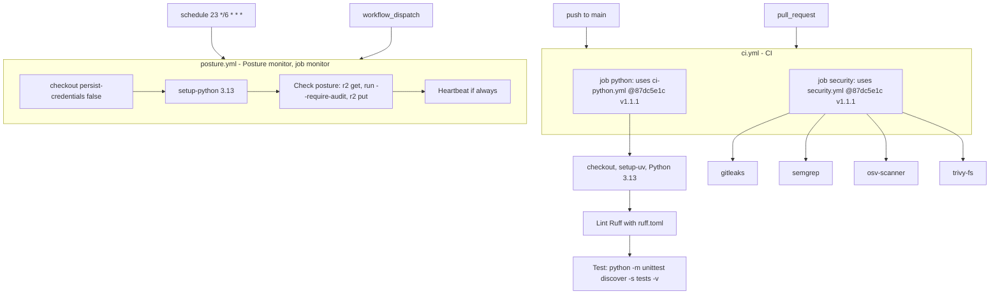

# 15 — CI/CD pipeline

Sources: `.github/workflows/ci.yml`, `.github/workflows/posture.yml`, platform-ci-workflows `.github/workflows/ci-python.yml` and `security.yml` @ `87dc5e1c` (step names), `ruff.toml`

Inputs ที่ repo ส่งให้ `ci-python`: `python-version: "3.13"`, `format-check: false` (follow-up: ruff format), `typecheck-command: ""` (ไม่มี type check), `test-command: python -m unittest discover -s tests -v`; ไม่มี coverage gate, ไม่มี Postgres

**ไม่มี deploy job:** CI ไม่ใช่ gate ของ `posture.yml` — run ถัดไปใช้ `main` ล่าสุดเสมอ ไม่ว่า CI ผ่านหรือไม่ (ดู 18)

## Open questions

- จะเปิด type check / coverage gate (TDD+SDD standard ADR-0004 opt-in) หรือไม่
