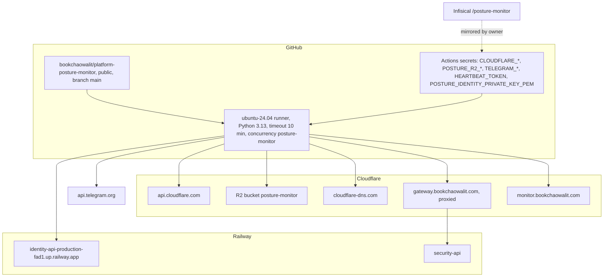

# 16 — Deployment

ไม่มี hosted runtime, Worker route หรือ custom domain ของตัวเอง โค้ดรันบน GitHub-hosted runner ชั่วคราวทุก 6 ชั่วโมง

Sources: `.github/workflows/posture.yml`, `posture_monitor/audit.py` (`IDENTITY`, `SECURITY_API`, rollback URL comment), `posture_monitor/collect.py`, `posture_monitor/r2.py`, `README.md` (Credentials), ops record: api-gateway-edge (2026-11-03)

| Env / config | Value source |
|---|---|
| Zone | `POSTURE_ZONE` env, default `bookchaowalit.com` (`run.py`) |
| R2 endpoint / keys | Actions secrets `POSTURE_R2_*` |
| Identity / security URLs | constants in `audit.py` (not env) |
| Heartbeat URL | literal in `posture.yml` |

## Open questions

- การ mirror Infisical → Actions secrets ทำมือหรือมี automation (README บอกแค่ "mirrored")
