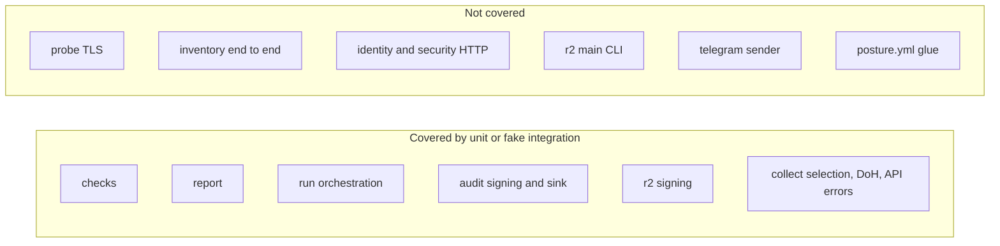

# 17 — Test coverage matrix

ชุด test คือ `unittest` (stdlib) 6 ไฟล์ รันใน CI ด้วย `python -m unittest discover -s tests -v` ทุก test เป็น unit / component test ที่ใช้ fake (opener, prober, sender, fake files) ไม่มี integration test กับ provider จริง และไม่มี e2e

| Feature | Unit | Integration (fakes, multi-module) | E2E / live | Test file(s) |
|---|---|---|---|---|
| Tunnel without Access (AC1) | yes | — | — | `test_checks.py` `TunnelAccess` |
| Access app enforcement | yes | — | — | `test_collect.py` `AccessApps` |
| Probe rules TLS / deployment (AC2) | yes | — | — | `test_checks.py` `ProbeRules` |
| `probe()` real TLS handshake | **gap** | — | — | none |
| Zone rules (AC3) | yes | — | — | `test_checks.py` `ZoneRules` |
| workers.dev rule | yes | — | — | `test_checks.py` `test_workers_dev` |
| Severity ordering | yes | — | — | `test_checks.py` `Ordering` |
| Web host selection, dangling CNAMEs | yes | — | — | `test_collect.py` `Selection` |
| DoH status handling | yes | — | — | `test_collect.py` `Doh` |
| Cloudflare client errors, paging (AC5 edge) | yes (fake opener) | — | — | `test_collect.py` `Api` |
| `Cloudflare.inventory()` end to end | **gap** | **gap** | — | none |
| Diff and message (AC4) | yes | — | — | `test_report.py` `Diff` |
| Public summary (AC6) | yes | yes | — | `test_report.py` `PublicSummary`; `test_run.py` `test_public_output_has_no_hostname` |
| Run orchestration, state write (R3, R4) | — | yes | — | `test_run.py` `Run` |
| Carry forward on unreachable host | — | yes | — | `test_run.py` `test_unreachable_host_keeps_its_probe_finding` |
| Pending alerts queue, cap 5 | — | yes | — | `test_run.py` |
| Generation, audit retry | — | yes | — | `test_run.py` |
| `--require-audit` | — | yes | — | `test_run.py` `RequireAudit` |
| JWT assertion + RS256 via openssl | yes | — | — | `test_audit.py` `Assertion` |
| Event target, idempotency key | yes | — | — | `test_audit.py` `Events` |
| AuditSink partial failure | yes | — | — | `test_audit.py` `Partial` |
| `service_token` / `post_event` real HTTP | **gap** | **gap** | — | none |
| R2 SigV4 signing | yes | — | — | `test_r2.py` `Signing` |
| `r2.main` get 404 / put CLI | **gap** | — | — | none |
| Telegram sender | **gap** | — | — | none (faked in `test_run.py`) |
| Workflow `posture.yml` bash glue | — | — | **gap** (only verified by real runs) | none |

Sources: `tests/test_checks.py`, `tests/test_collect.py`, `tests/test_report.py`, `tests/test_run.py`, `tests/test_audit.py`, `tests/test_r2.py`, `.github/workflows/ci.yml`

ไม่มี coverage % (ไม่มี coverage gate ใน `ci.yml`)

## Open questions

- ต้องการ smoke test กับ provider จริง (เช่น dry-run ด้วย `--no-notify` ใน CI) หรือพึ่ง `workflow_dispatch` หลัง push อย่างที่ทำอยู่ (ทุก feat/fix commit ที่ผ่านมามี dispatch run ตาม)
