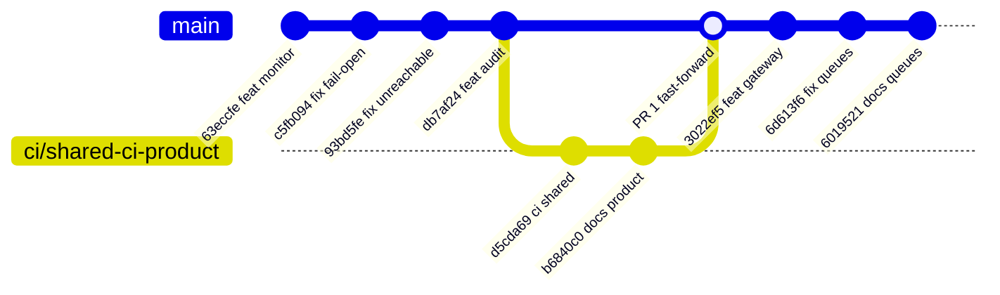
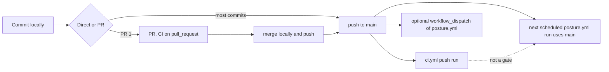

# 18 — Git & release workflow

หมายเหตุ: PR #1 ถูก merge แบบ fast-forward (ไม่มี merge commit ใน `git log --first-parent`); gitGraph ต้องมี merge node จึงแสดงเป็น merge

Sources: `git log --first-parent origin/main`, `gh pr list -R bookchaowalit/platform-posture-monitor --state all` (PR #1 `ci/shared-ci-product`, merged 2026-11-03 05:21 UTC), `gh run list -R bookchaowalit/platform-posture-monitor`, `.github/workflows/ci.yml`, `.github/workflows/posture.yml`, `gh api .../branches/main/protection` (404), ops record: merge-locally (2026-11-03)

- ไม่มี tag / GitHub release
- ไม่มี branch protection: CI ไม่ block push เข้า `main`

## Open questions

- ต้องการให้ `posture.yml` รันเฉพาะ SHA ที่ CI ผ่าน (เช่น `workflow_run`) หรือไม่
