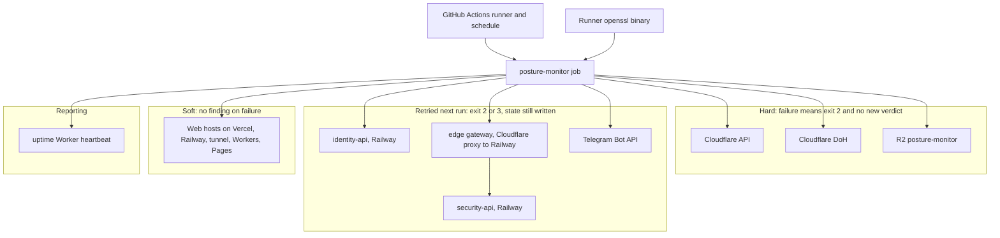

# 19 — Service dependency map (runtime)

Sources: `posture_monitor/run.py`, `posture_monitor/collect.py`, `posture_monitor/audit.py`, `posture_monitor/r2.py`, `.github/workflows/posture.yml`, `README.md` (How it runs), ops record: api-gateway-edge (2026-11-03)

ไม่มี database, CDN หรือ SDK ของ third-party; ทุก dependency เป็น HTTPS ด้วย stdlib

## Open questions

- gateway มี rate-limit 60 req / 10 s ต่อ IP (ops record api-gateway-edge): จำนวน audit event ต่อ run (เช่น baseline หลาย finding) อาจชนหรือไม่ — repo ไม่มี throttle
