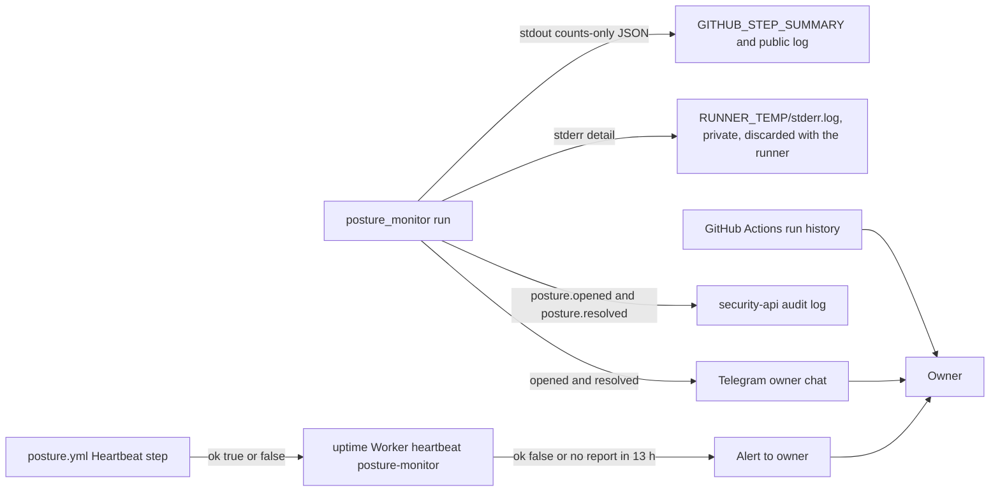

# 20 — Observability

ไม่มี Sentry / PostHog / metrics (Sentry waiver ใน `PRODUCT.md`, ADR-0005) สัญญาณที่มีจริง

Sources: `posture_monitor/run.py` (`public_summary` output, status fields), `posture_monitor/report.py`, `posture_monitor/audit.py`, `.github/workflows/posture.yml`, `PRODUCT.md` (Sentry waiver, Measures), `README.md`

| Signal | Content | Watched by |
|---|---|---|
| Step summary JSON | `high`, `medium`, `low`, `opened`, `resolved`, `status` (`provider_failed` / `audit_failed` / `notify_failed`), `audit_pending`, `alerts_pending` | owner in Actions UI |
| Telegram | baseline / changes message, highest severity first, ≤ 40 lines, ≤ 4000 chars | owner |
| security-api audit | one event per change | query in security-api (consumer not in this repo) |
| Heartbeat `posture-monitor` | `{"ok":true,"failed":[]}` or `{"ok":false,"failed":["posture-monitor"]}` | uptime Worker, 13 h window |

Measures (`PRODUCT.md`): heartbeat `ok: true` อย่างน้อยทุก 13 ชั่วโมง; จำนวน findings ที่เปิดอยู่ (baseline 2026-11-03: 10 low — ops record: posture-monitor (2026-11-03) ระบุ NET-06, NET-08, NET-10)

## Open questions

- ไม่มี dashboard ของจำนวน findings ตามเวลา; ต้องการหรือไม่ (ข้อมูลมีใน security-api)
- run duration (R5 < 5 นาที) ไม่ได้ถูกวัดหรือ alert
