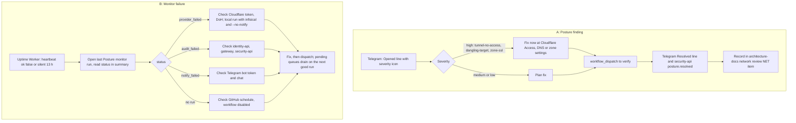

# 21 — Incident response

มีสอง incident class: (A) edge posture finding เปิด (เป็น "incident" ของระบบอื่นที่ monitor ตรวจเจอ) และ (B) ตัว monitor เองล้มหรือหาย ไม่มี runbook / postmortem template ใน repo; flow ด้านล่างประกอบจาก alert channel ที่มีจริง

Sources: `posture_monitor/report.py` (`message`, `ICON`), `posture_monitor/checks.py` (severities), `posture_monitor/run.py` (status values), `.github/workflows/posture.yml`, `README.md` (How it runs, Local run, Rotation), central doc [network-architecture.md §10](https://github.com/bookchaowalit/architecture-docs/blob/main/systems/architecture/network-architecture.md)

ขั้น A7 มาจาก network-architecture.md §10 ("close or re-date each finding") ที่ยังใช้เป็น manual review คู่กัน

## Open questions

- ไม่มี severity → response time target (เช่น high ต้องแก้ภายในกี่ชั่วโมง)
- ไม่มี postmortem template หรือที่เก็บ postmortem
- GitHub ปิด scheduled workflow อัตโนมัติใน public repo ที่ไม่มี activity 60 วัน — ตอนนั้น heartbeat จะเป็นตัวจับ แต่ไม่มีขั้นตอนเขียนไว้
