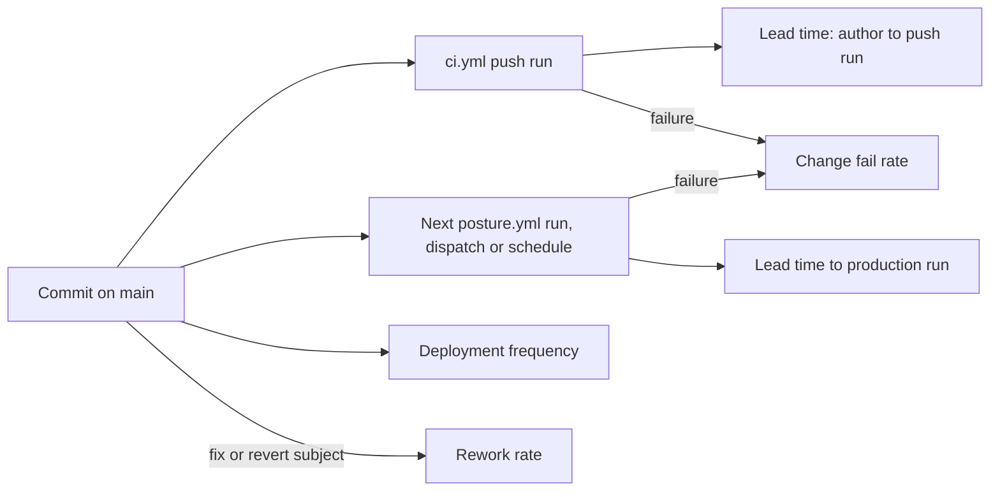

# 22 — DORA metrics

ช่วงวัด: 90 วัน **2026-08-05 → 2026-11-03** (วัด 2026-11-03 หลัง `git fetch`) — repo เกิด 2026-11-03 (`63eccfe`) ข้อมูลทั้งหมดจึงมาจากวันเดียว ตัวเลขเป็น baseline ไม่ใช่ trend

**นิยาม deployment:** ไม่มี deploy job; commit บน `main` คือ deployment เพราะ `posture.yml` run ถัดไป checkout `main` (ADR-0001) "production run" คือ `posture.yml` run ทั้ง `workflow_dispatch` และ `schedule`

| Metric | How measured here | Value (90 days) | Command |
|---|---|---|---|
| Deployment frequency | first-parent commits on `origin/main` | **9 deploys on 1 day** (2026-11-03) | `git log --first-parent --since=2026-08-05 --format='%ad' --date=short origin/main \| sort \| uniq -c` |
| Lead time for changes | (a) author time → `ci.yml` push run on `main` that contains the commit; (b) author time → first `posture.yml` run on a SHA that contains it | (a) **median 6 s**, max 4 m 59 s (`d5cda69`, via PR #1); (b) **median 1.5 min**: `63eccfe` 1.5 min, `c5fb094` 14 s, `93bd5fe` 7.5 min, `db7af24` 6 s, `d5cda69`/`b6840c0` ≈ 41 min, `3022ef5` 6 s, `6d613f6` 6 s, `6019521` 8 h 13 min (first scheduled run) | `git log --first-parent --format='%h %aI' origin/main`; `gh run list -R bookchaowalit/platform-posture-monitor -L 100 --json workflowName,event,headSha,createdAt,conclusion` |
| Change fail rate | (a) `ci.yml` push runs on `main` with `failure`; (b) `posture.yml` runs with `failure` | (a) **0 / 8 = 0 %**; (b) **0 / 6 = 0 %** (5 dispatch + 1 schedule, all `success`) | same `gh run list` |
| Failed deployment recovery time | red run → next green run on `main` | **not computable**: no failed run in the window | same `gh run list` |
| Deployment rework rate | first-parent commits whose subject starts with `fix` or `revert` | **3 / 9 = 33 %** (`c5fb094`, `93bd5fe`, `6d613f6`, all review fixes the same day) | `git log --first-parent --since=2026-08-05 --format='%h %s' origin/main \| grep -E '^[0-9a-f]+ (fix\|revert\|Revert)'` |

Sources: `git log origin/main` (9 commits, `63eccfe` → `6019521`), `gh run list -R bookchaowalit/platform-posture-monitor` (16 runs: CI 8 push + 2 pull_request, Posture monitor 5 workflow_dispatch + 1 schedule), `gh pr list` (PR #1), `.github/workflows/ci.yml`, `.github/workflows/posture.yml`

## Caveats

- ข้อมูลหนึ่งวัน: ค่าทั้งหมดเป็นของ initial build ไม่ใช่ steady state
- scheduled run แรก `2026-11-03T14:27:56Z` ช้ากว่า slot cron (`23 */6`) ตามที่ GitHub schedule เลื่อนได้ จึงทำให้ lead time (b) ของ `6019521` สูง
- commit `93bd5fe` ไม่มี dispatch ของตัวเอง; ใช้ run ของ `db7af24` เป็น production run แรกที่มีมัน

## Open questions

- จะนับ dispatch run (ที่ owner รันเพื่อ verify) เป็น production deployment หรือไม่
- จะเก็บค่าเหล่านี้อัตโนมัติใน scorecard หรือคำนวณมือรายไตรมาส
